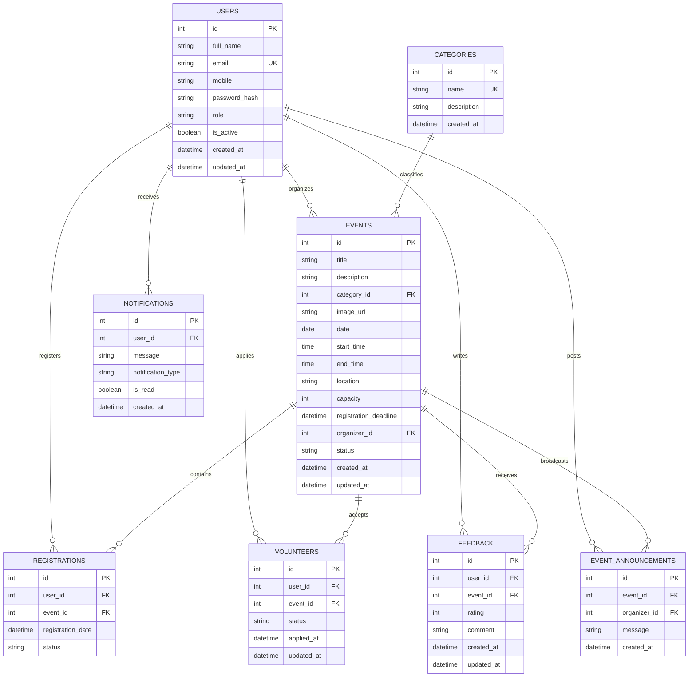

# COLLEGE COMMUNITY ENGAGEMENT PROJECT (CEP) REPORT
## Community Event Management and Participation System (CEMPS)

**Academic Year:** 2026  
**Discipline:** Information Technology / Computer Engineering (Second-Year / Third-Year CEP)  
**Project Domain:** Web Application Development, Database Engineering & Community Service  

---

## 1. Problem Statement

In academic institutions and local communities, extra-curricular civic engagement initiatives (such as NSS drives, blood donation camps, environmental cleanups, youth technical literacy workshops, and NGO charity outreach) suffer from fragmented, manual coordination:

1. **Manual Paper Registration:** Physical sign-up sheets lead to inaccurate participant tallies, unreadable contact info, and lost paperwork.
2. **Overcrowding & Resource Scarcity:** Without real-time capacity control, venues frequently exceed maximum seating or experience severe resource shortfalls (e.g., saplings, medical kits, refreshments).
3. **Disorganized Communication:** Critical updates, schedule adjustments, or venue changes are broadcasted through informal chat groups where messages are quickly buried.
4. **Lack of Accountability & Verification:** Institutional coordinators struggle to verify attendance or evaluate feedback for mandatory Community Engagement Project (CEP) accreditation.

---

## 2. Project Objectives

1. **Centralize Community Event Coordination:** Deliver a single web portal where approved organizers can publish events and students can discover activities.
2. **Enforce Real-Time Capacity Constraints:** Prevent overbooking with automatic seat decrementing and database-level unique constraints.
3. **Establish Multi-Tier Role Governance:** Implement Role-Based Access Control (RBAC) separating Participants, Organizers, and College Dean / Administrators.
4. **Automate Attendee Communication:** Provide an in-app notification engine for instant registration confirmations, event approvals, cancellations, and organizer broadcast alerts.
5. **Collect Transparent Post-Event Feedback:** Enable verified participants to submit 1–5 star ratings and reviews to measure civic impact.

---

## 3. Proposed Solution

The **Community Event Management and Participation System (CEMPS)** provides a full-stack, responsive, and secure digital solution:

- **Frontend:** Built with HTML5, CSS3, JavaScript ES6+, and Bootstrap 5.3, communicating with the backend purely through standard asynchronous Fetch API calls.
- **Backend:** High-performance Python FastAPI REST application implementing Pydantic data schemas, SQLAlchemy ORM, and secure JWT authentication.
- **Database:** Relational PostgreSQL schema (with automated Alembic migrations) enforcing relational foreign keys, cascade deletes, and unique participant-event constraints.

---

## 4. System Architecture

```mermaid
flowchart TD
    subgraph Presentation ["Presentation Layer (Frontend UI)"]
        UI_Home["Landing Page"]
        UI_Catalog["Event Discovery"]
        UI_Reg["Registrations & Volunteers"]
        UI_Dash["Role Dashboards"]
        UI_Admin["Admin Governance"]
    end

    subgraph API_Gateway ["Application & REST API Layer (FastAPI)"]
        Auth_MW["JWT Auth & Security Middleware"]
        Router_Auth["/api/auth"]
        Router_Events["/api/events"]
        Router_Reg["/api/events/{id}/register"]
        Router_Vol["/api/events/{id}/volunteer"]
        Router_Notif["/api/notifications"]
        Router_FB["/api/events/{id}/feedback"]
        Router_Admin["/api/admin"]
    end

    subgraph Service_Layer ["Business Logic & Services"]
        Service_Event["Event Capacity & Verification Engine"]
        Service_Notif["In-App Notification Dispatcher"]
    end

    subgraph Data_Layer ["Persistence Layer (PostgreSQL / SQLAlchemy)"]
        Table_Users[("Users")]
        Table_Cats[("Categories")]
        Table_Events[("Events")]
        Table_Regs[("Registrations")]
        Table_Vols[("Volunteers")]
        Table_Notifs[("Notifications")]
        Table_Feedback[("Feedback")]
        Table_Anns[("Announcements")]
    end

    Presentation -->|HTTP / JSON (Fetch API)| Auth_MW
    Auth_MW --> Router_Auth
    Auth_MW --> Router_Events
    Auth_MW --> Router_Reg
    Auth_MW --> Router_Vol
    Auth_MW --> Router_Notif
    Auth_MW --> Router_FB
    Auth_MW --> Router_Admin

    Router_Events --> Service_Event
    Router_Reg --> Service_Event
    Router_Reg --> Service_Notif
    Router_Vol --> Service_Notif
    Router_Admin --> Service_Notif

    Service_Event --> Data_Layer
    Service_Notif --> Data_Layer
```

---

## 5. Functional Modules Breakdown

### Module 1: Authentication & User Governance
- User registration with validation for email, mobile, and password length.
- Salting and hashing with `bcrypt` (no plaintext passwords).
- Role-based JWT token generation with expiration times.
- Granular dependencies: `require_admin`, `require_organizer`, `require_participant`.

### Module 2: Category Management
- Categorizes events into standard social sectors (Environment, Health, Education, Sports, Cultural, Technology, Community, Workshop, Seminar).
- Allows administrators to add, update, or remove categories while dynamically tracking live event counts.

### Module 3: Event Discovery & Lifecycle Management
- Events transition through defined lifecycle states:
  $$\text{Draft} \longrightarrow \text{Pending Approval} \xrightarrow{\text{Admin Review}} \text{Published / Approved} \longrightarrow \text{Completed}$$
- Filtering by date range, category, venue location, and full-text keyword search.
- Public users only see published and approved events.

### Module 4: Registration & Seat Management
- 9-step registration pipeline:
  1. Verify JWT authentication.
  2. Verify event status is Published or Approved.
  3. Verify current time does not exceed the registration deadline.
  4. Verify available seats ($Capacity - ConfirmedRegistrations > 0$).
  5. Check database for existing active registration.
  6. Insert new registration record.
  7. Compute remaining seats.
  8. Dispatch confirmation in-app notification to the attendee.
  9. Dispatch new-attendee notification to the organizer.

### Module 5: Volunteer Management
- Participants can volunteer their time for community projects.
- Organizers evaluate volunteer applications and update statuses: `Pending` -> `Approved` or `Rejected`.

### Module 6: Organizer Announcements & In-App Notifications
- Organizers post real-time announcements for their events.
- System automatically fans out notifications to all confirmed attendees.

### Module 7: Feedback & Reviews
- Participants submit 1–5 star ratings and qualitative reviews post-event.
- Prevents multiple reviews by the same user on the same event.
- Displays computed average rating on public event cards.

---

## 6. Database Schema & ER Diagram Description



### Relational Integrity Constraints
- `uq_user_event_registration`: Unique constraint on `(user_id, event_id)` in `registrations`.
- `uq_user_event_volunteer`: Unique constraint on `(user_id, event_id)` in `volunteers`.
- `uq_user_event_feedback`: Unique constraint on `(user_id, event_id)` in `feedback`.
- Foreign keys specify `ondelete="CASCADE"` to prevent orphaned child records upon event or user deletion.

---

## 7. Use-Case Descriptions

### Use Case 1: Participant Registers for an Event
- **Actor:** Participant (Student / Community Member)
- **Preconditions:** User is logged in; Event is in "Published" status; Current time < Registration Deadline; Capacity not full.
- **Main Flow:**
  1. Participant navigates to Event Details page.
  2. Participant clicks "Register for Event".
  3. Frontend sends `POST /api/events/{id}/register` with Bearer token.
  4. Backend verifies prerequisites and inserts record into `registrations`.
  5. In-app notification generated for attendee and organizer.
  6. Frontend receives HTTP 201 Created and displays confirmation toast.

### Use Case 2: Organizer Broadcasts Announcement
- **Actor:** Event Organizer
- **Preconditions:** Organizer is logged in and owns the event.
- **Main Flow:**
  1. Organizer opens "Manage Events" page.
  2. Organizer clicks Announcement icon on the event card.
  3. Organizer enters broadcast message (e.g. "Wear sturdy shoes").
  4. Backend retrieves all confirmed participants of that event and bulk-inserts notification records.
  5. Attendees receive real-time unread notification badge on next page load.

### Use Case 3: Admin Approves Event
- **Actor:** College Dean / System Administrator
- **Preconditions:** Admin is logged in; Organizer has submitted event for review.
- **Main Flow:**
  1. Admin opens Admin Control Center (`admin.html`).
  2. Under "Pending Event Approvals", Admin clicks "Approve".
  3. Backend updates status to "Published" and creates an in-app notification for the organizer.
  4. Event immediately appears on the public catalog and homepage highlights.

---

## 8. Data Flow Explanation (DFD Level 1)

1. **User Auth:** User submits credentials -> `POST /api/auth/login` -> Backend queries `users` table -> Verifies `bcrypt.checkpw()` -> Generates signed JWT payload -> Client saves token in `localStorage`.
2. **Event Creation:** Organizer fills form -> `POST /api/events` -> Backend validates payload with Pydantic -> Inserts `Event` with status "Pending Approval" -> Triggers notification to Dean.
3. **Approval:** Admin clicks Approve -> `PUT /api/admin/events/{id}/approve` -> Status updated to "Published" -> Organizer notified.
4. **Registration:** Participant clicks Register -> `POST /api/events/{id}/register` -> Backend executes transaction: checks deadline & capacity, inserts `Registration` -> Seat count dynamically updates -> Notification created.

---

## 9. Viva / Presentation Q&A Preparation

**Q1: Why did you choose FastAPI over Flask or Django?**  
*Answer:* FastAPI provides automatic Swagger/OpenAPI documentation, native Pydantic data validation, asynchronous performance, and type-hinting, which avoids boilerplate and reduces bugs.

**Q2: How do you prevent duplicate registrations when two users click at the same time?**  
*Answer:* We handle this at two layers:
1. Application layer: Check if registration exists before inserting.
2. Database layer: A `UniqueConstraint("user_id", "event_id")` ensures that even under concurrent race conditions, the database rejects duplicates with an integrity error.

**Q3: How is password security guaranteed?**  
*Answer:* Passwords are never stored in plain text. We utilize `bcrypt` with automated cryptographic salt generation, ensuring resilience against rainbow table attacks.

**Q4: How does the application scale for production?**  
*Answer:* The backend is stateless using JWT tokens, meaning FastAPI instances can scale horizontally behind a reverse proxy (like Nginx), while PostgreSQL handles pooled relational storage.

---

## 10. Future Scope

1. **QR Code Venue Check-In:** Digital QR code generation upon registration to scan attendees at the entrance.
2. **Automated CEP Certificate Generation:** Instant downloadable PDF certificates showing student volunteer hours.
3. **SMS / Email Gateway Integration:** Twilio / SendGrid integration for SMS updates.
4. **Interactive Map Coordinates:** Google Maps / Leaflet integration for venue directions.
